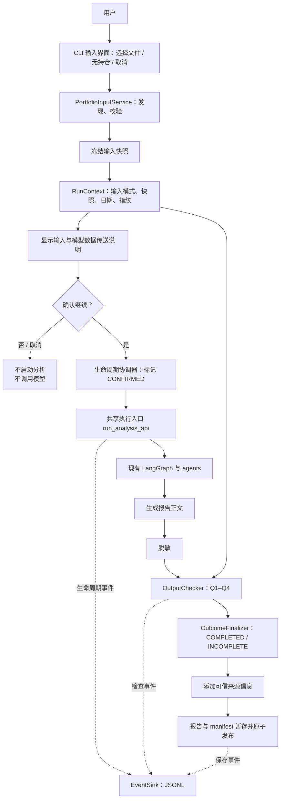
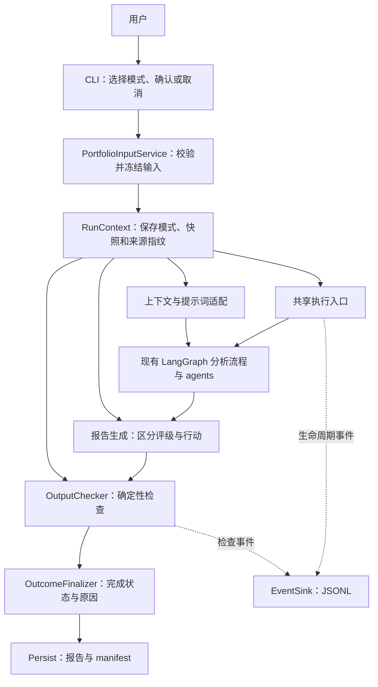
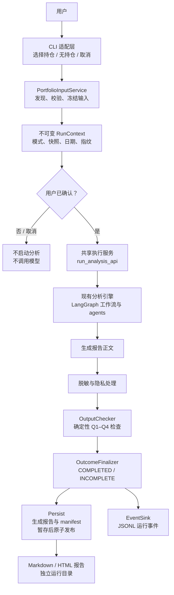

# Requirements and architecture discussion transcript — 2026-11-13

**Summary (English):** Full selected user/assistant exchanges about requirements conflicts, requirement improvements, and architecture-blueprint explanations. Timestamps are in Asia/Hong_Kong time. Unrelated turns are excluded.

### 13/11/2026 01:51:31

**User**

有没有这份架构方案申明可以解决但实际上并不能解决的需求

**Assistant**

我会对照架构草案、需求追踪文件和选定需求逐条核查，区分“方案里声称覆盖”与“设计实际能保证”的内容。

有。文件确实给每项需求分配了设计组件，但这表示“架构计划如何实现”，不等于“当前方案已经能保证满足”。追踪表里的测试编号和实现链接仍标为待定；当前这些组件也还是设计方案，尚不能据此认定需求已实现。

比较明确的缺口有：

- **SEL-TA-FR-004：防止代理在没有持仓资料时给出持仓相关建议。**方案要求无持仓时不假设用户拥有某只股票，并规定无持仓语境下 `Hold` 的含义。但设计也承认，`OutputChecker` 不检查叙述中的持仓归属语义；这部分依赖提示词和之后的语义评估。因此，方案能减少此类问题，却不能保证代理绝不给出针对假设持仓的建议。
- **SEL-TA-FR-007：确定性输出检查。**检查器只核对评级是否可读、报告信息是否匹配输入、免责声明是否存在，以及是否出现列出的保证性措辞。它不核实事实，也无法识别所有换种说法的保证性承诺。所以 `PASSED` 仅代表这些有限检查通过，不能代表报告整体正确或安全。
- **SEL-TA-NFR-003：敏感信息和持仓隐私。**方案提出对报告、日志和错误信息进行脱敏，但实际覆盖效果取决于实现是否把所有输出路径都接入脱敏器，并通过相应测试。目前追踪表的实现链接和测试编号均待补，因此还不能说隐私要求已被验证。
- **SEL-TA-NFR-006：评估统计的完整性。**方案定义了如何统计已开始运行、完成比例和失败原因，也定义了样本不足时的处理方式；但它依赖 `RunRecord` 等待实现的机制。设计给出了统计规则，不代表程序现在已经能可靠记录每一次运行。
- **SEL-TA-GOV-006：权限与治理执行。**权限模型说明了应如何限制文件访问，也明确写出治理设置尚未安装或验证。实际拦截和记录违规写入需要由 E 成员实施并演示，因此目前只有设计，不是已生效的控制。

另外，**SEL-TA-FR-005** 对“评级、研究经理建议和交易员行动分开标注”的要求有明确设计，但落地依赖报告渲染和提示词调整，也需要测试证明输出符合格式。

总体来说，最需要谨慎表述的是：架构草案对这些需求**提出了实现方案和检查边界**，但尚未证明实现完成。尤其是持仓语义、报告事实正确性、隐私覆盖和治理权限，方案本身都不能单独保证。

### 13/11/2026 01:43:05

**User**

请问目前的关于架构的文件有说明此架构能满足哪些需求吗，文件里有流程图吗

**Assistant**

有说明，但分散在几份文件中，还不是一份完整的“需求—架构对应表”。

- [架构草案](</Users/yifeng/Desktop/软工/project/CS5351-new/architecture-blueprint.md>) 说明了设计目标、组件和关键约束。
- [选定需求](</Users/yifeng/Desktop/软工/project/CS5351-new/docs/req/selected-requirements.md>) 列出拟实现的需求；[需求追踪输入](</Users/yifeng/Desktop/软工/project/CS5351-new/docs/architecture/traceability-inputs-member-b.md>) 提供架构与需求之间的追踪信息。因此可以看出架构打算覆盖哪些需求，但需求是否已获团队确认、是否已经实现，需要另外核对。

文件里**有流程图**：架构草案包含运行流程图，展示从输入持仓信息、确认数据传送，到分析、检查和输出报告的步骤。它描述的是计划中的运行流程，不代表这些组件已经全部实现。

### 13/11/2026 01:38:58

**User**

请你解释其中现有架构设计草案没有的组件分别是干什么

**Assistant**

严格来说，修正版图里**没有新增草案范围之外的独立组件**。有几步我单独画成了框，但草案把它们定义为现有组件的职责，而不是额外模块：

| 图中的框 | 草案中的对应设计 | 它做什么 | 是否独立组件 |
|---|---|---|---|
| **冻结输入快照** | `PortfolioInputService` 和 `RunContext` | 服务读取、校验输入并创建快照；`RunContext` 保存冻结后的内容和来源信息。 | 否，是输入服务产生数据、上下文保存数据的步骤。 |
| **显示输入与模型数据传送说明** | CLI 输入界面与确认流程 | 告知用户选中的文件、分析日期及持仓会发送给模型服务，再询问是否继续。 | 否，是 CLI 的交互行为，不是独立的 Notice 服务。 |
| **确认继续？** | 生命周期协调器（`RunLifecycleCoordinator`） | 记录输入从 `FROZEN` 变为 `CONFIRMED`；未确认就拒绝进入分析。 | 否，是协调器中的状态转换和检查。 |
| **添加可信来源信息** | 报告模块的 trusted envelope / metadata projection | 将可信的运行 ID、日期、输入模式和指纹等放入报告，不从模型文字取这些值。 | 否，是报告生成边界中的一个步骤。 |
| **不启动分析** | 输入取消/拒绝规则 | 取消、拒绝或输入无效时，不启动 graph，也不产生模型调用。 | 否，是流程结果。 |

其余框在草案中都有明确对应：`OutputChecker`、`OutcomeFinalizer`、`Redactor`、`Persist` 和 `EventSink` 都是计划中的组件；LangGraph 与 agents、报告渲染则是沿用或调整现有代码。

需要区分的是：这些模块**已写在架构草案里，但多数尚未实现**。例如，当前克隆中还没有计划中的 `tradingagents/runapi/` 目录，所以共享执行入口、输入服务、检查器和持久化模块目前仍是设计，不是可调用的代码。

### 13/11/2026 01:36:04

**User**

请比较刚才生成的流程图和目前的架构设计的区别

**Assistant**

上一张图与架构草案的**总体组件相同**，但它把几处关键步骤简化过头了，其中输入确认的顺序也画错了。

| 对比点 | 上一张流程图 | 架构草案的具体设计 |
|---|---|---|
| 输入与确认顺序 | CLI 选择并确认后，才校验和冻结输入 | 先选择并校验文件、冻结快照，再展示日期与数据传送说明并取得确认。只有确认后才运行和发送持仓给模型。 |
| 组件职责 | 把选择、确认都放在 CLI 一个框里 | CLI 的输入界面负责交互；`PortfolioInputService` 负责发现、校验和冻结；生命周期协调器负责 `FROZEN → CONFIRMED`。 |
| 输出检查顺序 | 报告生成后直接检查，再保存 | 先生成报告正文、脱敏，再由检查器核对；检查后才加可信的来源信息，并将报告和 manifest 暂存后原子发布。 |
| 运行状态与检查状态 | 检查器之后接 `OutcomeFinalizer`，两者关系较模糊 | 两者是独立结果：检查器给 `PASSED / NEEDS_REVIEW / NOT_RUN`；finalizer 给 `COMPLETED / INCOMPLETE` 和停止原因。未完成运行不执行输出检查。 |
| 日志和失败路径 | 只画了事件日志旁路 | 草案规定事件可来自输入、执行、检查和保存阶段；并区分关键产物保存失败与 best-effort 日志失败。 |
| 低层 API 路径 | 没画 | 直接调用底层 `TradingAgentsGraph` 可能绕过共享执行服务，不具备相同的检查和保存保证。 |

因此，上一张图最需要改正的是：**确认不应画在校验和冻结之前**。草案希望用户先看清自己选了什么文件、日期是什么、持仓会发送给哪个模型服务，再决定是否继续。

这张修正版图仍是**目标架构**，不是已实现代码。`runapi` 相关模块、原子发布和事件机制都还需要开发与测试；详细顺序见[架构蓝图](</Users/yifeng/Desktop/软工/project/CS5351-new/architecture-blueprint.md>)和[接口契约](</Users/yifeng/Desktop/软工/project/CS5351-new/docs/architecture/interface-contracts.md>)。

### 13/11/2026 01:31:46

**User**

要达到两种需求各五个的目标，你觉得还有哪些需求要实现技术上是较容易，以及如果增加它们目前的组件图要怎么调整

**Assistant**

按之前的目标——**5 个功能需求和 5 个非功能需求，且不把安全或治理类计入这五项 NFR**——我建议优先把现有需求整理成五组。这样不必额外发明功能，也能保留设计主线。

## 建议纳入的五组功能需求

新设计稿已有 7 项功能需求。若课程按“需求条目数”严格要求五项，可以把紧密相关的条目合并，并保留原验收点作为子条件：

| 建议的五项 | 对应现有需求 | 技术难度 |
|---|---|---|
| 1. 选择持仓或无持仓模式，并在运行前确认 | `SEL-TA-FR-001`、`FR-002` | **较容易**：主要是 CLI 选择、确认和取消流程。 |
| 2. 校验并冻结用户选择的输入 | `SEL-TA-FR-003` | **中等**：可复用已有 portfolio loader，但还需处理类型检查、日期匹配、不可变快照和指纹。 |
| 3. 将明确的输入状态传给分析流程，不猜测持仓或现金 | `SEL-TA-FR-004` | **较容易到中等**：需要调整上下文和提示词，并覆盖无持仓、空持仓、缺失现金等情况。 |
| 4. 区分最终评级、中间建议和交易行动，定义无持仓时的 `Hold` | `SEL-TA-FR-005` | **较容易**：主要涉及提示词和报告标签；但语义测试仍需设计。 |
| 5. 报告记录输入来源，并由程序检查结果 | `SEL-TA-FR-006`、`FR-007` | **中等**：要实现 provenance、报告 manifest 和 Q1–Q4 确定性检查。 |

第 5 项包含两种验收点：**输入来源是否正确记录**和**输出规则是否通过**，可以放在一个“可审计、经检查的结果”需求下，但测试时仍应分别验证。

## 建议纳入的五项非功能需求

从新设计稿的六项 NFR 中，排除安全/隐私类 `SEL-TA-NFR-003` 后，正好有五项：

| 非功能需求 | 技术难度 | 主要工作 |
|---|---|---|
| `SEL-TA-NFR-001` 可靠性 | 中等 | 将模型、数据和内部异常映射到明确的运行结果；可恢复的数据缺失继续按设计处理。 |
| `SEL-TA-NFR-002` 可观测性 | **较容易到中等** | 添加 JSONL 事件记录和固定字段；需处理并发事件及终态事件写入失败。 |
| `SEL-TA-NFR-004` 可复现性 | 中等偏高 | 每次运行独立保存 report 和 manifest，防止覆盖，并实现原子发布。 |
| `SEL-TA-NFR-005` 可维护、兼容的集成 | **较难** | 建立 CLI 和 Python API 共用的执行边界，确保检查、错误处理和保存流程不被绕过。 |
| `SEL-TA-NFR-006` 评估统计透明 | **较容易到中等** | 统计已开始、完成、需复核和未完成的运行，并规定样本数为零时不能判为通过。 |

如果按技术容易程度排序，我会先做 **FR-001/002 输入选择与确认、FR-004/005 上下文和评级语义、NFR-002 结构化事件、NFR-006 运行统计**；再做快照指纹、确定性检查、原子持久化和共享执行入口。

**安全/隐私需求 `SEL-TA-NFR-003` 不计入五项 NFR 数量，不代表可以忽略。**草案仍把它列为 Must，尤其是不得泄漏 key、不得在本地新日志中写入原始持仓，以及向模型服务发送持仓前必须告知用户。治理要求也应另行完成，不占五项 NFR 名额。

## 组件图如何调整

按这五组需求，图上不需要增加新的分析代理；需要把输入处理、共享执行、输出检查和保存职责画清楚。与上一张图相比，重点是把 **`RunContext` 同时连到分析上下文、报告和检查器**，并显示事件日志是旁路记录。

这张图里的输入服务、`RunContext`、共享执行入口、检查器、finalizer、持久化和事件组件都是**草案规划的新组件**，不是已完成实现。安全脱敏仍需在报告、日志、manifest 和异常输出的保存边界上单独落实。

### 13/11/2026 01:28:27

**User**

请问目前架构有哪些组件，可以画图出来吗

**Assistant**

我会按草案里的 C2 方案整理组件，并画一张流程图。图中会区分现有系统组件与计划新增的组件，避免把架构设计误读成已实现代码。

按草案，系统分为**输入与确认、分析执行、结果检查、产物保存**几个部分。图中实线流程是计划中的主路径；`runapi` 等服务目前仍是设计组件，尚未实现。

### 主要组件

- **CLI 与输入服务**：CLI 负责交互；`PortfolioInputService` 负责列出文件、校验格式并冻结输入。交互提示只放在 CLI 层。
- **`RunContext`**：保存本次运行确认过的输入模式和快照身份；分析和报告使用同一份冻结数据。
- **共享执行服务**：`run_analysis_api` 是计划中的统一入口，负责调度分析、处理异常、调用检查器和保存结果。
- **现有分析引擎**：TradingAgents 的 LangGraph、分析员和管理者继续执行研究流程；报告中的评级与中间行动会分开标示。
- **`OutputChecker`**：不调用模型，检查评级是否可读、报告输入信息是否匹配、免责声明是否存在，以及是否出现指定保证收益措辞。
- **`OutcomeFinalizer`**：将流程结果整理为 `COMPLETED` 或 `INCOMPLETE`，并记录原因；不完整运行没有最终评级。
- **产物与事件组件**：`Persist` 保存报告和 manifest，`EventSink` 记录结构化事件，`Redactor` 在输出前脱敏。

设计还保留一个重要边界：直接调用底层 `TradingAgentsGraph` 的低层接口可能绕过共享执行服务，因此不自动获得同等的输出检查和保存保证。设计将它列为兼容性路径，产品是否依赖它仍待确认。

以上是草案中的目标架构，具体模块和契约见[架构蓝图](</Users/yifeng/Desktop/软工/project/CS5351-new/architecture-blueprint.md>)与[接口契约](</Users/yifeng/Desktop/软工/project/CS5351-new/docs/architecture/interface-contracts.md>)。

### 13/11/2026 01:22:27

**User**

按这个设计实施的话，哪些需求可以被解决，哪些没有解决

**Assistant**

我会按 `CS5351-new` 里的选定需求和架构文件逐项区分：设计已经覆盖的目标、实施后仍只能部分满足的目标，以及明确延期或不在范围内的目标。也会把“设计已写出”和“代码已实现/测试通过”分开说明。

**如果按草案完成实现并通过验收测试，它能覆盖“可选持仓输入、输入可追踪、输出经过确定性检查”的工作范围；但不能据此认为整个 TradingAgents 项目或此前所有问题都已解决。**

### 设计覆盖的需求

| 需求 | 按设计实施后预期能做到什么 | 仍需注意 |
|---|---|---|
| `SEL-TA-FR-001–003` | CLI 让用户选择持仓文件、选择无持仓或取消；校验文件并冻结输入；取消或输入错误时不调用模型。 | 这是新增流程，必须实际实现和测试。 |
| `SEL-TA-FR-004–005` | 区分未提供持仓、空持仓和有持仓；区分研究评级与交易行动；避免把 `Hold` 解释成“维持用户现有仓位”。 | 提示词与语义评估负责部分文字行为；当前确定性检查器不能保证所有模型文字都不含个性化仓位建议。 |
| `SEL-TA-FR-006` | 报告和运行记录使用同一份已冻结的输入来源信息，包含运行 ID 和输入指纹；不同运行不互相覆盖。 | 指纹表明使用了哪份规范化输入，不证明用户提供的持仓真实。 |
| `SEL-TA-FR-007` | 由非模型组件执行 Q1–Q4 检查；模型不能自行声称通过。 | `PASSED` 只表示这些指定检查通过，不代表事实正确、证据充分或适合用户。 |
| `SEL-TA-NFR-001` | 按原因返回未完成结果；可恢复的数据缺失继续按现有行为处理；不可恢复的模型、数据或内部故障不冒充正常完成。 | 断电等无法由程序控制的情况不保证能留下记录。 |
| `SEL-TA-NFR-003–006` | 对指定输出脱敏；每次新运行独立保存；提供结构化运行事件；统计完成率、复核数及失败原因。 | 终端事件写入被设计为 best-effort；若写入失败，运行记录标 `durable=false`，这可能无法满足“每次运行都实际保存一条终端事件”的验收条件，需在实现前澄清。 |

需求细节见 [选定需求稿](</Users/yifeng/Desktop/软工/project/CS5351-new/docs/req/selected-requirements.md>)；输出检查和故障处理方案见[接口契约](</Users/yifeng/Desktop/软工/project/CS5351-new/docs/architecture/interface-contracts.md>)、[不变量清单](</Users/yifeng/Desktop/软工/project/CS5351-new/docs/architecture/invariants.md>)和[运行策略目录](</Users/yifeng/Desktop/软工/project/CS5351-new/docs/architecture/runtime-policy-catalog.md>)。

### 尚未解决或明确延期的事项

- **无持仓时对仓位建议的硬性禁止还不够明确。** 设计规定不假设用户持有该标的，也规定无持仓时 `Hold` 不表示维持现有仓位；但没有明确要求确定性组件阻止模型输出“买入多少股、配置多少比例”等建议。若这是团队必须保证的行为，应补成明确的需求和验收测试。
- **缺失数据如何影响建议没有纳入本次范围。** 设计保留可恢复的非核心数据缺失行为，但没有规定缺少新闻等数据时应如何影响评级、confidence 或是否转人工复核。
- **不验证来源可靠性或结论真实性。** 设计记录输入来源，但没有全局来源置信度评分，也没有事实正确性验证。
- **若干旧需求被明确延期。** 包括完整的多渠道证据 ID 注册、额外历史数据筛选/新鲜度规则、仓位和敞口认证、检查点恢复重设计、总运行时间/token/调用次数预算、辩论收敛和分析员插件化。设计也不包含网页 GUI、经纪商连接或真实下单。
- **治理门槛不会因架构文档而自动生效。** `SEL-TA-GOV-001–006` 还需成员 C、D、E 和团队完成测试审批、CI、权限和分支保护等工作；评估标准也有待确定。
- **范围仍待批准。** 这份选定范围重新纳入了“可选持仓输入”，与此前考虑推迟持仓功能的方向不同；需求稿明确要求成员 A/团队确认。

### 当前完成状态

以上都是“按设计实施后的预期”，不是已经实现的功能。草案中规划的 `tradingagents/runapi/` 目录目前尚不存在，设计文档也明确说明测试和治理执行尚未完成。此外，草案以 TradingAgents **v0.7.1** 为基线，而原文件夹是 **v0.5.0**；实施前需要先处理版本差异，否则不能直接把设计中的模块和代码路径视为适用于旧基线。

### 13/11/2026 01:19:43

**User**

请问这份设计草案旨在满足哪些需求，新增文件有无完整的需求表

**Assistant**

这份设计草案针对的是一个**有限的工作范围**：给现有 CLI 增加“可选提供持仓”的输入流程，并加强输入来源追踪、输出检查和运行记录。它不是整个 TradingAgents 项目的完整架构或全部需求。

## 它要支持的 7 项功能需求

需求编号和说明列在 [selected-requirements.md](</Users/yifeng/Desktop/软工/project/CS5351-new/docs/req/selected-requirements.md>)：

1. **FR-001 发现并选择持仓文件**：让用户从指定目录中选择文件，或选择不提供持仓；不得静默选中某个文件。
2. **FR-002 明确确认输入模式**：开始分析前显示说明并取得确认；拒绝或取消时不调用模型。
3. **FR-003 校验并冻结持仓快照**：检查输入格式、数量和日期；确认后使用冻结的内容，不因文件后续改变而改变本次输入。
4. **FR-004 明确传递持仓上下文**：区分“未提供持仓”和“持仓为空”，不得把未知持仓或现金当成零。
5. **FR-005 区分评级和行动**：区分 Buy/Hold 等评级与具体行动措辞，并处理无持仓时 `Hold` 的表达。
6. **FR-006 报告记录确定性输入来源**：报告中的输入模式、日期及快照标识来自可信的冻结输入，而不是模型生成的文本。
7. **FR-007 由确定性代码检查输出**：模型不能自行宣布检查通过；检查失败时进入复核结果。

## 它要支持的 6 项非功能需求

- **NFR-001 可靠性**：模型或数据故障时给出类型明确的未完成结果，不让异常无声逃逸。
- **NFR-002 可观测性**：输出包含固定字段的结构化运行事件。
- **NFR-003 凭据和持仓隐私**：脱敏日志与错误信息，不把原始持仓内容写入新增记录；向模型服务传递持仓前先告知用户。
- **NFR-004 可复现性**：每次新运行有独立 ID、报告目录和 manifest，不能覆盖先前运行。
- **NFR-005 可维护、兼容的集成**：用共享执行边界连接 CLI 和 Python 入口，避免把交互提示塞进分析代理或引擎。
- **NFR-006 透明的评估统计**：报告完成率、需复核数量和未完成原因；零个完成样本不能算评估通过。

这些 NFR 的详细设计分别分布在[接口契约](</Users/yifeng/Desktop/软工/project/CS5351-new/docs/architecture/interface-contracts.md>)、[不变量清单](</Users/yifeng/Desktop/软工/project/CS5351-new/docs/architecture/invariants.md>)、[运行策略目录](</Users/yifeng/Desktop/软工/project/CS5351-new/docs/architecture/runtime-policy-catalog.md>)和[记忆与状态设计](</Users/yifeng/Desktop/软工/project/CS5351-new/docs/architecture/memory-design.md>)中。

此外，需求草稿还列了 6 项课程治理要求，例如测试计划先批准、需求注册表 schema 检查、回归和 CI 门槛、AI 使用记录、安全变更的人工审查。这些是**额外的治理要求**，不是上述 7 项功能需求或 6 项 NFR；架构作者提供部分设计，实施和执行责任分给其他成员。

## 新增文件里有没有完整需求表？

有一份**本次设计范围的需求清单**：`docs/req/selected-requirements.md`，包含 7 项功能需求、6 项 NFR 和 6 项治理要求，并提供了陈述、验收条件和责任分工等信息。

但它**不是完整的项目需求表，也不是最终获批的课程 D1 注册表**。文件自己明确标为工作版本，要求成员 A/团队后续批准；其中的治理需求还要求另行提供最终 YAML 和 JSON Schema。文件也明确把若干需求排除在本次范围之外，例如网页 GUI、下单/经纪商连接、敞口认证、检查点恢复重设计、总运行时间或 token 预算、来源置信度评分等。

还要特别留意：这套选定范围**重新纳入了可选持仓输入**，与先前考虑将持仓功能推迟的方向不同，因此需要团队确认是否接受。它强调不假设持仓和现金，但不提供完整的账户敞口或仓位认证。
