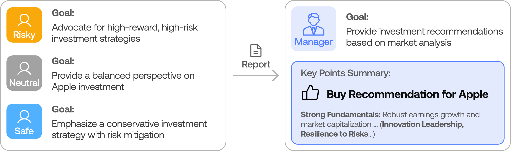
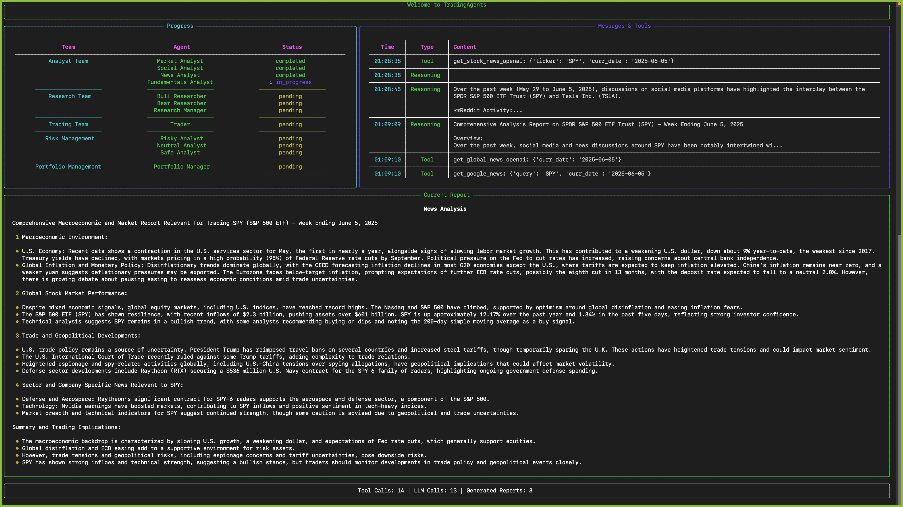

<p align="center">
  
</p>

<div align="center" style="line-height: 1;">
  <a href="https://arxiv.org/abs/2412.20138" target="_blank"></a>
  <a href="https://discord.com/invite/hk9PGKShPK" target="_blank"></a>
  <a href="https://x.com/TauricResearch" target="_blank"></a>
  <a href="https://github.com/TauricResearch/" target="_blank"></a>
</div>
<br>
<div align="center">
  <a href="https://github.com/TauricResearch" target="_blank"></a>
</div>
<br>
<div align="center">
  <!-- Keep these links. Translations will automatically update with the README. -->
  <a href="https://www.readme-i18n.com/TauricResearch/TradingAgents?lang=de">Deutsch</a> | 
  <a href="https://www.readme-i18n.com/TauricResearch/TradingAgents?lang=es">Español</a> | 
  <a href="https://www.readme-i18n.com/TauricResearch/TradingAgents?lang=fr">français</a> | 
  <a href="https://www.readme-i18n.com/TauricResearch/TradingAgents?lang=ja">日本語</a> | 
  <a href="https://www.readme-i18n.com/TauricResearch/TradingAgents?lang=ko">한국어</a> | 
  <a href="https://www.readme-i18n.com/TauricResearch/TradingAgents?lang=pt">Português</a> | 
  <a href="https://www.readme-i18n.com/TauricResearch/TradingAgents?lang=ru">Русский</a> | 
  <a href="https://www.readme-i18n.com/TauricResearch/TradingAgents?lang=zh">中文</a>
</div>

---

# TradingAgents: Multi-Agents LLM Financial Trading Framework

## News
- [2026-08] **TradingAgents v0.4.0** released with look-ahead / point-in-time fixes across FRED macro, social sentiment, and the decision-log memory; clearer decision signals; working CLI checkpoint resume; Trader price grounding; and the GPT-5.6 and GLM-5.3 models. See [CHANGELOG.md](CHANGELOG.md) for the full list.
- [2026-07] **TradingAgents v0.3.1** released with correctness and stability fixes: Alpha Vantage look-ahead filtering, graph-router crash-safety, graph-shape-aware checkpoint resume, working crypto sentiment sources, a configurable LLM retry budget, Bedrock API-key auth, and Claude Sonnet 5 / Fable 5 support.
- [2026-06] **TradingAgents v0.3.0** released with a verified data-access contract, an expanded provider registry (NVIDIA, Kimi, Groq, Mistral, Bedrock, and any OpenAI-compatible endpoint), FRED and Polymarket data vendors, a current-generation model catalog, and a CI gate.
- [2026-05] **TradingAgents v0.2.5** released with the grounded Sentiment Analyst, GPT-5.5 etc. model coverage, Qwen/GLM/MiniMax dual-region support, `TRADINGAGENTS_*` env-var configurability with API-key auto-detection, remote Ollama support, non-US alpha benchmarks, and ticker path-traversal hardening.
- [2026-04] **TradingAgents v0.2.4** released with structured-output agents (Research Manager, Trader, Portfolio Manager), LangGraph checkpoint resume, persistent decision log, DeepSeek/Qwen/GLM/Azure provider support, Docker, and a Windows UTF-8 encoding fix.
- [2026-03] **TradingAgents v0.2.3** released with multi-language support, GPT-5.4 family models, unified model catalog, backtesting date fidelity, and proxy support.
- [2026-03] **TradingAgents v0.2.2** released with GPT-5.4/Gemini 3.1/Claude 4.6 model coverage, five-tier rating scale, OpenAI Responses API, Anthropic effort control, and cross-platform stability.
- [2026-02] **TradingAgents v0.2.0** released with multi-provider LLM support (GPT-5.x, Gemini 3.x, Claude 4.x, Grok 4.x) and improved system architecture.
- [2026-01] **Trading-R1** [Technical Report](https://arxiv.org/abs/2509.11420) released, with [Terminal](https://github.com/TauricResearch/Trading-R1) expected to land soon.

<div align="center">

🚀 [TradingAgents](#tradingagents-framework) | ⚡ [Installation & CLI](#installation-and-cli) | 🎬 [Demo](https://www.youtube.com/watch?v=90gr5lwjIho) | 📦 [Package Usage](#tradingagents-package) | 🤝 [Contributing](#contributing) | 📄 [Citation](#citation)

</div>

> 🎉 **TradingAgents** officially released! We have received numerous inquiries about the work, and we would like to express our thanks for the enthusiasm in our community.
>
> So we decided to fully open-source the framework. Looking forward to building impactful projects with you!

## TradingAgents Framework

TradingAgents is a multi-agent trading framework that mirrors the dynamics of real-world trading firms. By deploying specialized LLM-powered agents: from fundamental analysts, sentiment experts, and technical analysts, to trader, risk management team, the platform collaboratively evaluates market conditions and informs trading decisions. Moreover, these agents engage in dynamic discussions to pinpoint the optimal strategy.

<p align="center">
  
</p>

> TradingAgents framework is designed for research purposes. Trading performance may vary based on many factors, including the chosen backbone language models, model temperature, trading periods, the quality of data, and other non-deterministic factors. [It is not intended as financial, investment, or trading advice.](https://tauric.ai/disclaimer/)

Our framework decomposes complex trading tasks into specialized roles.

### Analyst Team
- Fundamentals Analyst: Evaluates company financials and performance metrics, identifying intrinsic values and potential red flags. On this fork it also reviews dividend history (per-share trend, cuts, yield and payout) to judge dividend sustainability, and compares the current dividend yield, P/B and P/E with the stock's own multi-year history.
- Sentiment Analyst: Aggregates news headlines, StockTwits, Reddit chatter, and (for Bursa Malaysia tickers) KLSE Screener comments into a single sentiment read to gauge short-term market mood.
- News Analyst: Monitors global news and macroeconomic indicators, interpreting the impact of events on market conditions.
- Technical Analyst: Utilizes technical indicators (like MACD and RSI) to detect trading patterns and forecast price movements.

<p align="center">
  
</p>

### Researcher Team
- Comprises both bullish and bearish researchers who critically assess the insights provided by the Analyst Team. Through structured debates, they balance potential gains against inherent risks.

<p align="center">
  
</p>

### Trader Agent
- Composes reports from the analysts and researchers to make informed trading decisions, determining the timing and magnitude of trades.

<p align="center">
  
</p>

### Risk Management and Portfolio Manager
- Continuously evaluates portfolio risk by assessing market volatility, liquidity, and other risk factors. The risk management team evaluates and adjusts trading strategies, providing assessment reports to the Portfolio Manager for final decision.
- The Portfolio Manager approves/rejects the transaction proposal. If approved, the order will be sent to the simulated exchange and executed.

<p align="center">
  
</p>

## Installation and CLI

### Installation

Clone TradingAgents:
```bash
git clone https://github.com/TauricResearch/TradingAgents.git
cd TradingAgents
```

Create a virtual environment in any of your favorite environment managers:
```bash
conda create -n tradingagents python=3.12
conda activate tradingagents
```

Install the package and its dependencies:
```bash
pip install .
```

### Docker

Alternatively, run with Docker:
```bash
cp .env.example .env  # add your API keys
docker compose run --rm tradingagents
```

For local models with Ollama:
```bash
docker compose --profile ollama run --rm tradingagents-ollama
```

### Required APIs

TradingAgents supports multiple LLM providers. Set the API key for your chosen provider:

```bash
export OPENAI_API_KEY=...          # OpenAI (GPT)
export GOOGLE_API_KEY=...          # Google (Gemini)
export ANTHROPIC_API_KEY=...       # Anthropic (Claude)
export XAI_API_KEY=...             # xAI (Grok)
export DEEPSEEK_API_KEY=...        # DeepSeek
export DASHSCOPE_API_KEY=...       # Qwen — International (dashscope-intl.aliyuncs.com)
export DASHSCOPE_CN_API_KEY=...    # Qwen — China (dashscope.aliyuncs.com)
export ZHIPU_API_KEY=...           # GLM via Z.AI (international)
export ZHIPU_CN_API_KEY=...        # GLM via BigModel (China, open.bigmodel.cn)
export MINIMAX_API_KEY=...         # MiniMax — Global (api.minimax.io)
export MINIMAX_CN_API_KEY=...      # MiniMax — China (api.minimaxi.com)
export OPENROUTER_API_KEY=...      # OpenRouter
export ALPHA_VANTAGE_API_KEY=...   # Alpha Vantage
```

For Azure OpenAI, copy `.env.enterprise.example` to `.env.enterprise` and fill in your credentials.

For AWS Bedrock, install the extra with `pip install ".[bedrock]"`, set `llm_provider: "bedrock"`, configure AWS credentials (environment variables, `~/.aws/credentials`, or an IAM role) and `AWS_DEFAULT_REGION`, and use a Bedrock model ID, e.g. `us.anthropic.claude-opus-4-8-v1:0`.

For local models, configure Ollama with `llm_provider: "ollama"`. The default endpoint is `http://localhost:11434/v1`; set `OLLAMA_BASE_URL` to point at a remote `ollama-serve`. Pull models with `ollama pull <name>`, and pick "Custom model ID" in the CLI for any model not listed by default.

For any other OpenAI-compatible server (vLLM, LM Studio, llama.cpp, or a custom relay), use `llm_provider: "openai_compatible"` and set the endpoint via `backend_url` (or `TRADINGAGENTS_LLM_BACKEND_URL`), e.g. `http://localhost:8000/v1` for vLLM or `http://localhost:1234/v1` for LM Studio. The model is whatever your server serves. No key is needed for local servers; set `OPENAI_COMPATIBLE_API_KEY` when the endpoint requires one.

Alternatively, copy `.env.example` to `.env` and fill in your keys:
```bash
cp .env.example .env
```

### CLI Usage

Launch the interactive CLI:
```bash
tradingagents          # installed command
python -m cli.main     # alternative: run directly from source
```
You will see a screen where you can select your desired tickers, analysis date, LLM provider, research depth, and more.

### Markets and tickers

TradingAgents works with any market Yahoo Finance covers, using the exchange-suffixed ticker. Company identity and the alpha benchmark resolve automatically per market.

- US: `AAPL`, `SPY`
- Hong Kong: `0700.HK` · Tokyo: `7203.T` · London: `AZN.L`
- India: `RELIANCE.NS`, `.BO` · Canada: `.TO` · Australia: `.AX`
- China A-shares: Shanghai `.SS`, Shenzhen `.SZ` (e.g. `600519.SS` for Kweichow Moutai)
- Malaysia (Bursa/KLSE): `.KL` (e.g. `1155.KL` for Malayan Banking / Maybank)
- Crypto: `BTC-USD`, `ETH-USD`

<p align="center">
  
</p>

An interface will appear showing results as they load, letting you track the agent's progress as it runs.

<p align="center">
  
</p>

<p align="center">
  
</p>

## Bursa Malaysia (KLSE) customizations

> This section documents fork-specific additions on the `bursa` branch, kept
> separate from `main` (a clean mirror of [upstream](https://github.com/TauricResearch/TradingAgents))
> so upstream updates keep merging cleanly.

Reddit and StockTwits — the sentiment analyst's default social sources — carry
almost no discussion of Bursa-listed names. Malaysia's other usual retail
source, i3investor, sits behind Cloudflare bot-protection that blocks a plain
HTTP fetcher; klsescreener.com does not (its comment thread is server-rendered
plain HTML), so this fork adds a fetcher for it and lets the existing
graceful-degradation behavior handle everything else:

- **Regional alpha benchmark**: `.KL` tickers now resolve to the FBM KLCI
  (`^KLSE`) instead of falling back to SPY (`tradingagents/default_config.py`, `benchmark_map`).
- **`google_news_my` news vendor** (`tradingagents/dataflows/google_news_my.py`):
  a keyless, MY-localized Google News RSS source that resolves a ticker to its
  company name and aggregates The Edge Malaysia, The Star, NST, Bernama and
  others — with genuine server-side date bounding, so historical runs get
  point-in-time-correct results. This is the **default `news_data` vendor on
  this branch** (`"google_news_my,yfinance"` — tries the MY source first,
  falls back to yfinance so non-KLSE tickers still get news), so both the CLI
  and the Python API use it automatically; no config needed. To use yfinance
  only (e.g. comparing behavior against upstream):
  ```python
  config = DEFAULT_CONFIG.copy()
  config["data_vendors"] = {**config["data_vendors"], "news_data": "yfinance"}
  ```
- **`bnm` macro vendor** (`tradingagents/dataflows/bnm.py`): Malaysia's own
  macro data from Bank Negara Malaysia's keyless public API — the **Overnight
  Policy Rate** (`opr`) and the **Kuala Lumpur USD/MYR reference rate**
  (`usd_myr`). FRED, the upstream macro vendor, is a US series library, so a
  Bursa run asking for "the policy rate" previously got the *federal funds
  rate* and reasoned about KLSE names through US monetary policy. This is the
  **default `macro_data` vendor chain on this branch** (`"bnm,fred"`): BNM
  answers Malaysian indicators, and anything it does not serve falls through to
  FRED for the US/global backdrop. The fallthrough is free — BNM rejects a
  non-Malaysian indicator from a local table, with no network call.

  Two details worth knowing. Both BNM series are **revision-free** (an MPC
  decision and a day's reference rate are published once, never restated), so
  unlike FRED's revision-prone CPI/GDP they need no vintage pin — filtering to
  the as-of date is point-in-time correct on its own. And the OPR is a **step
  series**: BNM publishes decisions, not a daily level, so a window with no
  decision means the rate was *unchanged*, which this vendor reports as such
  (carrying the prevailing level forward) rather than as missing data.
- **Malaysian FRED aliases** (`tradingagents/dataflows/fred.py`): `malaysia_cpi`,
  `malaysia_gdp`, `malaysia_10y`, `malaysia_bond_yield`. These are OECD/IMF
  relays rather than FRED originals, so they lag the national release and are
  occasionally retired upstream — prefer `bnm` for the policy rate and the
  ringgit, which come straight from Bank Negara.
- **Market-aware macro prompting** (`get_macro_guidance` in
  `tradingagents/agents/utils/agent_utils.py`): a `.KL` ticker steers the news
  analyst to `opr`/`usd_myr` first, spells out that a rising USD/MYR is a
  *weaker* ringgit, and keeps the US series available as the external backdrop
  (US rates drive foreign flows into Bursa) without letting them stand in for
  Malaysia's own conditions. Non-MY tickers keep the upstream US guidance.
- **`klse_screener` sentiment source** (`tradingagents/dataflows/klse_screener.py`):
  fetches the retail comment thread for a `.KL` ticker's own stock page on
  klsescreener.com — a mix of English, Malay and Chinese chatter, and the
  closest Bursa equivalent to a StockTwits cashtag stream for a market where
  StockTwits itself is silent. Comments carry no user-labeled Bullish/Bearish
  tag (the sentiment analyst reads tone from the text, same as Reddit), and
  each is attributed with its like count and whether it's a top-level comment
  or a reply. Wired into the sentiment analyst as a fourth pre-fetched source
  alongside news/StockTwits/Reddit; for a non-`.KL` ticker it short-circuits to
  a `<not applicable>` placeholder with no network call, so nothing changes
  for non-Bursa runs. Degrades the same way as the other social sources: a
  failed fetch reports `<unavailable>`, never "no comments found", so an
  outage is never mistaken for genuine silence.
- **`get_dividend_history` tool** (`tradingagents/dataflows/y_finance.py`):
  gives the fundamentals analyst a dividend report for the ticker:
  - a summary: trailing 12-month dividend per share (DPS) and yield, latest
    ex-date, years of unbroken payments, 5-year DPS growth rate, and any year
    whose total fell below the year before;
  - DPS by calendar year (grouped by ex-date) with year-on-year change;
  - the last 8 ex-dates and amounts;
  - a cash payout ratio per fiscal year (dividends paid ÷ net income, both
    from the cash flow statement).

  It is point-in-time: dividends, prices and fiscal periods after the
  analysis date are left out, so backtests don't see later dividends. The
  yield uses the unadjusted close. Amounts are per share in the quote
  currency (RM for `.KL`) and adjusted by Yahoo for splits and bonus issues,
  so older years may not match the originally announced figures; special
  dividends are not separated from regular ones. It has its own
  `dividend_data` vendor category (default `yfinance`), so pointing
  `fundamental_data` at `alpha_vantage` doesn't leave it without a vendor,
  and a Yahoo outage reports the data as unavailable instead of stopping the
  run. To check it directly:
  ```bash
  python -c "from tradingagents.dataflows.y_finance import get_dividend_history as g; print(g('1155.KL', '2026-10-09'))"
  ```
- **`get_valuation_history` tool** (`tradingagents/dataflows/y_finance.py`):
  compares the current dividend yield, price-to-book (P/B) and
  price-to-earnings (P/E) with the stock's own monthly history — average and
  ±1 std band, median, low and high with dates, where the current value sits
  (e.g. "cheap vs own history: higher than 8% of months"), plus year-end
  snapshots and the fiscal years used.
  - The **dividend-yield band covers the full 10 years** (prices and dividends
    only).
  - **P/B and P/E cover only about the last 4 fiscal years**, because Yahoo
    serves at most 4 years of annual statements; the output states each
    band's coverage. They use market cap ÷ full-year net income or equity,
    with each fiscal year's share count restated for later splits and bonus
    issues (Yahoo adjusts old prices but not old EPS, so price ÷ EPS would
    understate older multiples).
  - Point-in-time: prices and dividends after the analysis date are left out,
    and a fiscal year is only used from two months after it ends (Bursa's
    reporting deadline).
  - Own `valuation_data` vendor category (default `yfinance`), handled the
    same way as `dividend_data`. To check it directly:
    ```bash
    python -c "from tradingagents.dataflows.y_finance import get_valuation_history as g; print(g('1155.KL', '2026-10-09'))"
    ```

### Long-term dividend investor mode

Upstream TradingAgents behaves like a short-term trading desk: it learns from
5-day returns, sets ATR-based stop-losses, sizes trades as "% of portfolio",
and has a risk team that champions "high-reward, high-risk" bets. That is the
wrong lens for a retail investor who buys Bursa blue chips in small amounts
every few months and holds them for years for the dividends. This fork
re-frames the whole pipeline for that investor. The pieces below work
together; each can be changed or switched off independently.

#### 1. Investor profile

`investor_profile` in `tradingagents/default_config.py` is a shared
instruction appended to every agent's prompt (analysts, researchers, risk
analysts, managers and trader), so the whole pipeline rates the stock for the
same holder. The default describes a long-term, income-focused retail holder
of Bursa Malaysia stocks (2–5 years, longer for stable high-yield blue chips)
who buys in small tranches every few months. It tells every agent to:

- base the rating mainly on dividend sustainability (payout covered by free
  cash flow, consistent dividend record), earnings stability, balance-sheet
  strength (asset quality and capital for banks) and valuation versus the
  stock's own history;
- state how many 100-share board lots one purchase buys, and its RM cost;
- avoid frequent trading, because fees are a meaningful share of a small order;
- never recommend stop-losses or short-term profit-taking, and recommend
  selling only when the investment thesis breaks (dividend cut, sustained
  earnings decline, rising debt, governance problems);
- use technical indicators only to suggest staged entry prices, never to
  change the rating.

**Your own figures stay private.** Portfolio size, purchase amount and
holdings do not belong in the committed default (this repository is public).
Put them in a plain-text file at `~/.tradingagents/investor_profile.txt`,
which is outside the repo, and its contents are appended to the profile on
every run. A missing or empty file adds nothing. Override the path with
`TRADINGAGENTS_INVESTOR_PROFILE_FILE`. Example:
```text
Total portfolio is about RM50,000. Each new purchase is RM2,000-3,000,
made every 2-3 months.
```
To replace the general profile itself, or disable it:
```bash
# .env
TRADINGAGENTS_INVESTOR_PROFILE="Long-term growth investor, 5-year horizon."
```
```python
config = DEFAULT_CONFIG.copy()
config["investor_profile"] = ""   # disable entirely (an empty env var is ignored)
```

#### 2. Decision memory judged over a year, not 5 days

The decision log (see [Decision log](#decision-log)) scores each past
decision once its outcome is known and turns it into a short "lesson" that
the Portfolio Manager reads on later runs. Upstream scores a decision on its
**5-trading-day** return. For a 2–5 year dividend holder that is noise, and
worse, it teaches the system short-term timing.

`reflection_holding_days` (default `250`, about one year of Bursa trading
days; env `TRADINGAGENTS_REFLECTION_HOLDING_DAYS`) sets the window instead:

- The stock's return is a **total return including dividends** (yfinance's
  dividend-adjusted close).
- The `^KLSE` (FBM KLCI) benchmark is a **price-only** index, so a dividend
  stock's alpha looks better than it really is by roughly the index's
  dividend yield. The reflection prompt is told this.
- The reflection judges whether the long-term thesis held (dividend,
  earnings, balance sheet, valuation), not short-term direction.

What this means in practice: a decision needs about a year before it is
scored, so the memory stays quiet for the first year. That is intended. Set
`TRADINGAGENTS_REFLECTION_HOLDING_DAYS=5` to restore upstream behavior.

#### 3. Trader: a staged purchase plan instead of a stop-loss

A stop-loss on a dividend blue chip mostly turns a temporary price dip into a
realised loss. The Trader (`TraderProposal` in
`tradingagents/agents/schemas.py`, prompt in
`tradingagents/agents/trader/trader.py`) now produces a purchase plan,
grounded in support levels and moving averages rather than ATR:

| Field | Meaning |
|---|---|
| Entry Price | Price for the first purchase |
| Add-on Price | Optional lower price for a second, staged purchase (e.g. near support) |
| Lots per Purchase | 100-share board lots one purchase buys. The share count and cost are computed in code (lots × 100 × entry price), e.g. "2 (200 shares, about 1,970.00 at the entry price)", so the arithmetic is exact |
| Position Sizing | In the investor's terms: the amount for this purchase, buy all now or split over 1–2 purchases, and keep any one stock within roughly 10–15% of the portfolio |
| Sell If | Conditions that would break the thesis (dividend cut, sustained earnings decline, rising debt, governance problems) |
| ~~Stop Loss~~ | Removed |

#### 4. Rating scale for a long-term holder

The Research Manager and Portfolio Manager share one scale
(`RATING_SCALE_GUIDE` in `tradingagents/agents/utils/rating.py`). The five
words are unchanged, because signal parsing, the memory log and the schemas
rely on them, but their meaning is now:

| Rating | Upstream meaning | Meaning in this fork |
|---|---|---|
| **Buy** | Strong conviction to enter or add | Strong long-term case at an attractive price: accumulate now |
| **Overweight** | Gradually increase exposure | Good case, but the price is only fair: accumulate gradually or on dips |
| **Hold** | Maintain position, no action | Keep holding and collect the dividends; don't add at this price |
| **Underweight** | Reduce exposure, take partial profits | Thesis weakening: stop adding and watch, but don't sell yet |
| **Sell** | Exit or avoid | Thesis broken (dividend cut, sustained earnings decline, balance-sheet or governance problems): exit, or avoid if not held |

The Portfolio Manager also:

- compares the dividend yield and expected total return with the low-risk
  alternatives the investor could hold instead (fixed deposits, which track
  Bank Negara's OPR, EPF dividends and ASB distributions), and says whether
  the stock's extra return justifies its equity risk. It cites rates for
  those alternatives only when the reports provide them, so it does not
  invent FD or EPF figures;
- summarises staged entry, sizing, thesis-break conditions and holding
  period (instead of "key risk levels"), with a holding-period example of
  "2-5 years" (instead of "3-6 months").

#### 5. Risk debate from a long-term holder's viewpoint

The three risk analysts (`tradingagents/agents/risk_mgmt/`) keep their names,
because the graph routing and the CLI use them, but argue different things.
All three now argue from fundamentals and valuation rather than price
momentum or chatter.

| Analyst | Upstream | This fork |
|---|---|---|
| **Aggressive** | "High-reward, high-risk… outpace market norms" | Long-term total return: dividends that grow, earnings that compound, and the cost of sitting out. Pushes back when the plan is too timid (e.g. waiting for a perfect dip on a quality stock at a fair price). Never argues for leverage, speculation or short-term trading |
| **Conservative** | Protect "the firm's assets" from volatility | Protect the investor's capital and dividend income: is the dividend covered by free cash flow, has it been cut before, is a high yield a trap left by a falling share price? Also debt, earnings cyclicality, governance, concentration in one stock or sector, and whether an FD, EPF or ASB would pay about the same for far less risk |
| **Neutral** | A general "balanced approach" | Valuation and entry timing: is the price cheap, fair or expensive against the stock's own history (yield, P/B, P/E), and should the investor buy the full amount now, split it over 1–2 purchases, or wait |


#### 6. Malaysian news topics from trusted sources

The news analyst's macro headlines come from the `google_news_my` vendor
(`tradingagents/dataflows/google_news_my.py`). Three changes make them fit a
Bursa dividend holder:

- **Topics** (`DEFAULT_MY_QUERIES`, override with `my_news_queries`): the
  things that move Bursa blue chips and a dividend holder's returns. Each
  wording was checked against the live feed; short queries match far more
  articles than long ones.

  | Query | Why it matters |
  |---|---|
  | Bursa Malaysia KLCI | Overall market direction |
  | foreign funds Bursa | Weekly foreign net buying or selling, a main driver of blue-chip prices |
  | OPR Bank Negara | Policy rate: bank margins, and the FD rates a dividend competes with |
  | ringgit | A stronger ringgit draws foreign funds back |
  | Malaysia bond yields | The low-risk yield a dividend stock is compared against; rising yields weigh on banks and REITs |
  | palm oil prices | Plantation earnings and dividends |
  | oil prices Petronas | Oil and gas stocks and the government's revenue |
  | Malaysia budget | Tax, dividend and sector measures |
  | Malaysia economy | GDP, inflation, consumer demand |
  | Federal Reserve interest rates | US rates drive foreign money into and out of Bursa |

- **Trusted sources only** (`TRUSTED_MY_NEWS_SOURCES`, override with
  `trusted_news_sources`, or set `trusted_news_only` to `False` to keep
  everything). In a test week about a third of Google's results came from
  machine-written stock blurbs (AD HOC NEWS), broker and crypto pages
  (Moomoo, TradingView, CoinGecko) or sites that only re-post other outlets
  (Newswav, KLSE Screener). Results are now limited to:
  - Malaysian business press: The Edge Malaysia, The Star, New Straits Times,
    Business Times, The Malaysian Reserve, BusinessToday, Focus Malaysia, BFM
  - the national news agency: Bernama
  - Malaysian general press: Malay Mail, Free Malaysia Today, Malaysiakini,
    The Sun, The Vibes, Astro Awani, Sinar Daily, Borneo Post
  - regional and international: Reuters, Bloomberg, Nikkei Asia, CNA, The
    Business Times, The Straits Times, SCMP, Financial Times
  - official bodies: Bank Negara Malaysia, Bursa Malaysia, Securities
    Commission, DOSM, Ministry of Finance, MPOB

  For a smaller company covered only by minor sites, those articles are still
  shown, flagged as unverified, rather than reported as "no news".
- **Every topic gets its share.** Previously the vendor stopped once it had
  10 articles, and the first query ("Bursa Malaysia KLCI") always returned
  more than that, so the OPR, ringgit and budget searches never ran. Each
  topic now gets an equal share of `global_news_article_limit` (raised to
  20, two per topic), and any unused share is filled from the others.

The yfinance fallback (`global_news_queries`, used only if Google News
fails) cannot find Malaysian news at all, so it now covers just the external
backdrop: US rates, China, Asian fund flows, oil and trade policy.

#### 7. CLI defaults

- **All four analysts are ticked** when the analyst menu opens, so pressing
  Enter runs the full team. Untick one with Space. For a long-term holder the
  Fundamentals and News analysts carry the rating; the Market analyst only
  informs staged entry prices, and the Sentiment analyst (including KLSE
  Screener chatter) is useful context but should not drive a multi-year
  decision.
- **Medium research depth** (3 debate and risk rounds) is highlighted, a
  balance between a thorough debate and API cost.
- **Temperature is left at each provider's default.** A lower temperature
  makes answers more repeatable, but it is forwarded to the provider as-is,
  and reasoning models (the default GPT-5.x family, and Claude with
  extended thinking) reject any value other than 1. If you use a model that
  honors it, set `TRADINGAGENTS_TEMPERATURE=0.2` in `.env`. DeepSeek V4
  (`deepseek-v4-flash`, `deepseek-v4-pro`) is safe either way: it never
  rejects the parameter, honors it in non-thinking mode, and silently uses
  1.0 in thinking mode, so the setting helps only on non-thinking calls.
  Either way, run
  important decisions two or three times and compare the ratings (see
  [Reproducibility](#reproducibility)).

## TradingAgents Package

### Implementation Details

We built TradingAgents with LangGraph to ensure flexibility and modularity. The framework supports multiple LLM providers: OpenAI, Google, Anthropic, xAI, DeepSeek, Qwen (Alibaba DashScope, international and China endpoints), GLM (Zhipu), MiniMax (global + China), OpenRouter, Ollama for local models, and Azure OpenAI for enterprise.

### Python Usage

To use TradingAgents inside your code, you can import the `tradingagents` module and initialize a `TradingAgentsGraph()` object. The `.propagate()` function will return a decision. You can run `main.py`, here's also a quick example:

```python
from tradingagents.graph.trading_graph import TradingAgentsGraph
from tradingagents.default_config import DEFAULT_CONFIG

ta = TradingAgentsGraph(debug=True, config=DEFAULT_CONFIG.copy())

# forward propagate
_, decision = ta.propagate("NVDA", "2026-01-15")
print(decision)
```

You can also adjust the default configuration to set your own choice of LLMs, debate rounds, etc.

```python
from tradingagents.graph.trading_graph import TradingAgentsGraph
from tradingagents.default_config import DEFAULT_CONFIG

config = DEFAULT_CONFIG.copy()
config["llm_provider"] = "openai"        # e.g. openai, google, anthropic, deepseek, groq, ollama; openai_compatible covers any OpenAI-compatible endpoint (vLLM, LM Studio, llama.cpp, ...)
config["deep_think_llm"] = "gpt-5.6"      # Model for complex reasoning
config["quick_think_llm"] = "gpt-5.6-luna" # Model for quick tasks
config["max_debate_rounds"] = 2

ta = TradingAgentsGraph(debug=True, config=config)
_, decision = ta.propagate("NVDA", "2026-01-15")
print(decision)
```

See `tradingagents/default_config.py` for all configuration options.

## Persistence and Recovery

TradingAgents persists two kinds of state across runs.

### Decision log

The decision log is always on. Each completed run appends its decision to `~/.tradingagents/memory/trading_memory.md`. On the next run for the same ticker, TradingAgents fetches the realised return (raw and alpha vs SPY), generates a one-paragraph reflection, and injects the most recent same-ticker decisions plus recent cross-ticker lessons into the Portfolio Manager prompt, so each analysis carries forward what worked and what didn't. On this fork the realised return is measured over about a year (dividends included) rather than 5 trading days, so a decision only resolves once it is about a year old; see [Decision memory judged over a year](#2-decision-memory-judged-over-a-year-not-5-days).

Override the path with `TRADINGAGENTS_MEMORY_LOG_PATH`.

### Checkpoint resume

Checkpoint resume is opt-in via `--checkpoint`. When enabled, LangGraph saves state after each node so a crashed or interrupted run resumes from the last successful step instead of starting over. On a resume run you will see `Resuming from step N for <TICKER> on <date>` in the logs; on a new run you will see `Starting fresh`. Checkpoints are cleared automatically on successful completion.

Per-ticker SQLite databases live at `~/.tradingagents/cache/checkpoints/<TICKER>.db` (override the base with `TRADINGAGENTS_CACHE_DIR`). Use `--clear-checkpoints` to reset all of them before a run.

```bash
tradingagents analyze --checkpoint           # enable for this run
tradingagents analyze --clear-checkpoints    # reset before running
```

```python
config = DEFAULT_CONFIG.copy()
config["checkpoint_enabled"] = True
ta = TradingAgentsGraph(config=config)
_, decision = ta.propagate("NVDA", "2026-01-15")
```

## Reproducibility

TradingAgents is LLM-driven, so two runs of the same ticker and date can differ. This is expected for a research tool built on language models, not a defect. The variation comes from a few distinct sources, and it helps to separate them.

Language model sampling is non-deterministic. Even at a fixed temperature, providers do not guarantee byte-identical output across calls, and reasoning models (the default GPT-5.x family, and any thinking-mode model) vary the most because their internal reasoning is itself sampled.

Live data moves. News, StockTwits, and Reddit return different content as time passes, so a run today sees different inputs than a run last week even for the same historical trade date. Pin the analysis date to hold the price and indicator window fixed, but the social and news sources still reflect "now".

To reduce variation you can lower the sampling temperature. Set `temperature` in your config (or `TRADINGAGENTS_TEMPERATURE` in `.env`); lower values make models that honor it more repeatable. The current curated models are reasoning-first and largely ignore temperature, so for tighter reproducibility use a non-reasoning model, which you can set explicitly via the Custom model ID option.

```python
config = DEFAULT_CONFIG.copy()
config["llm_provider"] = "openai"
config["temperature"] = 0.0
# Reasoning models ignore temperature. For tighter reproducibility, set a
# non-reasoning deep/quick model explicitly (e.g. via the Custom model ID option).
```

What does not vary anymore: the analyzed company identity is resolved deterministically from the ticker before any agent runs, and the market analyst grounds exact price and indicator claims in a verified data snapshot. Earlier reports of "different companies" or fabricated price levels across runs are addressed by these two mechanisms.

Backtest results are not guaranteed to match any published figure. Returns depend on the model, the temperature, the date range, data quality, and the sampling above. Treat the framework as a research scaffold for studying multi-agent analysis, not as a strategy with a fixed, replicable return.

## Contributing

Contributions are welcome: bug fixes, documentation, and feature ideas; past contributions are credited per release in [`CHANGELOG.md`](CHANGELOG.md).

## Citation

Please reference our work if you find *TradingAgents* provides you with some help :)

```
@misc{xiao2025tradingagentsmultiagentsllmfinancial,
      title={TradingAgents: Multi-Agents LLM Financial Trading Framework}, 
      author={Yijia Xiao and Edward Sun and Di Luo and Wei Wang},
      year={2025},
      eprint={2412.20138},
      archivePrefix={arXiv},
      primaryClass={q-fin.TR},
      url={https://arxiv.org/abs/2412.20138}, 
}
```
