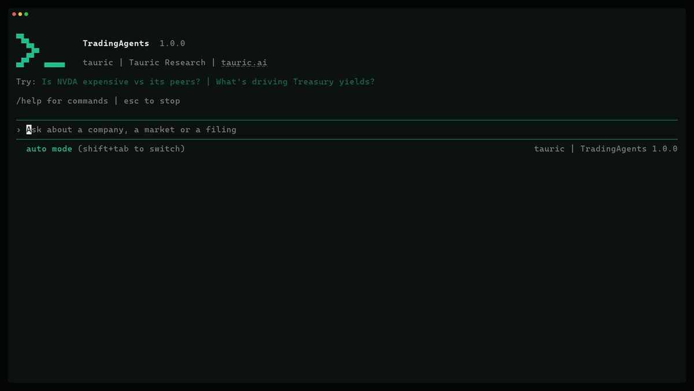
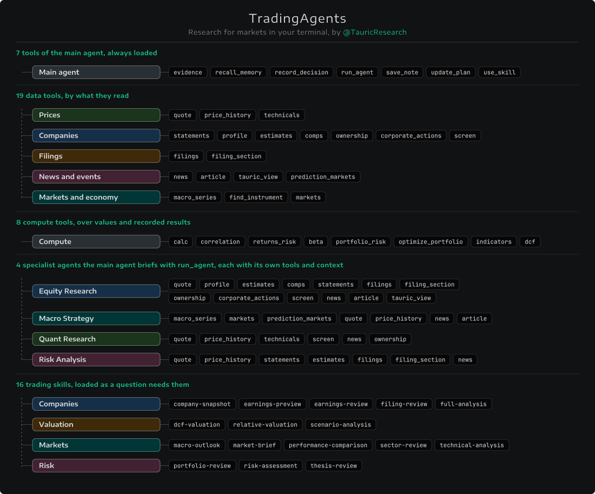

<p align="center">
  <a href="https://tauric.ai/">
    <picture>
      <source media="(prefers-color-scheme: dark)" srcset="assets/tauric-logo-dark.svg">
      
    </picture>
  </a>
</p>

<p align="center">
  <a href="https://arxiv.org/abs/2412.20138"></a>
  <a href="https://x.com/TauricResearch"></a>
  <a href="https://github.com/TauricResearch/"></a>
  <a href="https://www.youtube.com/@TauricResearch"></a>
  <a href="https://tauric.ai/"></a>
</p>

<p align="center">
  <a href="https://tauric.ai/"></a>
</p>

<p align="center">
  <a href="https://tauricresearch.github.io/TradingAgents/">English</a> |
  <a href="https://tauricresearch.github.io/TradingAgents/de/">Deutsch</a> |
  <a href="https://tauricresearch.github.io/TradingAgents/es/">Español</a> |
  <a href="https://tauricresearch.github.io/TradingAgents/fr/">français</a> |
  <a href="https://tauricresearch.github.io/TradingAgents/ja/">日本語</a> |
  <a href="https://tauricresearch.github.io/TradingAgents/ko/">한국어</a> |
  <a href="https://tauricresearch.github.io/TradingAgents/pt/">Português</a> |
  <a href="https://tauricresearch.github.io/TradingAgents/ru/">Русский</a> |
  <a href="https://tauricresearch.github.io/TradingAgents/zh/">中文</a>
</p>

<h1 align="center">TradingAgents: Towards Agentic Finance Research</h1>

<p align="center">
  
</p>

## Quick start

**1. Get an API key**

- Sign up at [Tauric Research](https://tauric.ai/signup).
- Create your [Tauric API key](https://tauric.ai/settings/api-keys).

**2. Install**

```bash
curl -fsSL https://tauric.ai/tradingagents/install.sh | sh
```

Or with npm: `npm i -g @tauric/tradingagents`

**3. Run**

```bash
tradingagents
```

Start your agentic finance research with Tauric!

## Models

| Provider                                               | Needs                                      |
| ------------------------------------------------------ | ------------------------------------------ |
| Tauric AI                                              | [Tauric API key](https://tauric.ai/signup) |
| OpenAI, Anthropic, Google, DeepSeek, OpenRouter, LLMTR | their API key                              |
| Self-hosted models (vLLM, Ollama)                      | its address and model                      |
| AI subscriptions (ChatGPT)                             | `tradingagents login chatgpt`              |

With another provider, `/login` adds a Tauric API key for filings, statements and news. See
[docs/models.md](docs/models.md).

## Usage

Type a question and press Enter. Every figure in the answer is marked with its source, and a numbered list of
sources follows.

| Command   | Does                                                             |
| --------- | ---------------------------------------------------------------- |
| `/`       | Open the commands                                                |
| `/model`  | Choose the model and how hard it reasons                         |
| `/resume` | Resume an earlier session                                        |
| `/export` | Save the last answer as a PDF report, or the session as Markdown |
| `/copy`   | Copy the last answer                                             |
| `/help`   | List every command and key                                       |

Shift+Tab switches to plan mode, where the agent proposes a research plan first.

## Architecture

<p align="center">
  
</p>

## Agents and skills

The main agent plans the research, reads what the question needs with its data tools, and works the numbers
with its compute tools. For depth, it briefs specialist agents, each in its own context:

| Agent           | Covers                                                                           |
| --------------- | -------------------------------------------------------------------------------- |
| Equity Research | a company's statements, filings, estimates, valuation, ownership and news        |
| Macro Strategy  | growth, inflation, rates and the yield curve, credit, sectors, cross-asset moves |
| Quant Research  | returns, volatility, drawdowns, correlation and beta, technical indicators       |
| Risk Analysis   | what could make a position lose, and what would show it early                    |

For a known kind of research it follows a skill:

| Area      | Skills                                                                                 |
| --------- | -------------------------------------------------------------------------------------- |
| Companies | company snapshot, earnings preview and review, filing review, full analysis            |
| Valuation | DCF, relative valuation, scenario analysis                                             |
| Markets   | macro outlook, market brief, performance comparison, sector review, technical analysis |
| Risk      | portfolio review, risk assessment, thesis review                                       |

You can add your own agents and skills as Markdown files ([docs/usage.md](docs/usage.md)). TradingAgents researches
and answers; it does not place trades.

## Documentation

- [Install](docs/install.md): the installer, npm, release files and updates.
- [Usage](docs/usage.md): the terminal, one-off questions, sessions, agents and skills, sources, sync and limits.
- [Models](docs/models.md): providers, keys, reasoning and OpenAI-compatible servers.
- [Configuration](docs/configuration.md): files and environment variables.

To report an issue or open a pull request, see [CONTRIBUTING.md](CONTRIBUTING.md); to report a security problem, [SECURITY.md](SECURITY.md).

## Citation

```bibtex
@article{xiao2024tradingagents,
  title={TradingAgents: Multi-agents LLM financial trading framework},
  author={Xiao, Yijia and Sun, Edward and Luo, Di and Wang, Wei},
  journal={arXiv preprint arXiv:2412.20138},
  year={2024}
}
```

## License

Apache-2.0. See [LICENSE](LICENSE).
