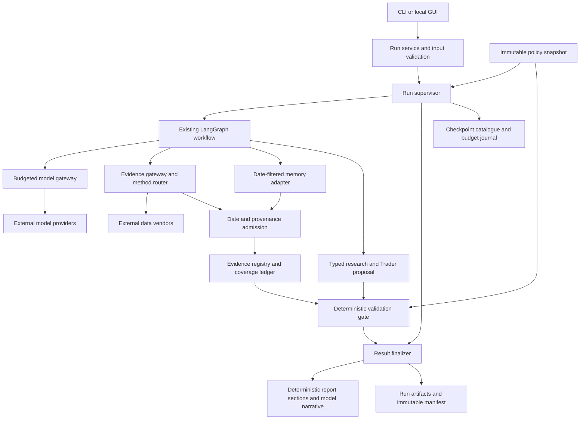
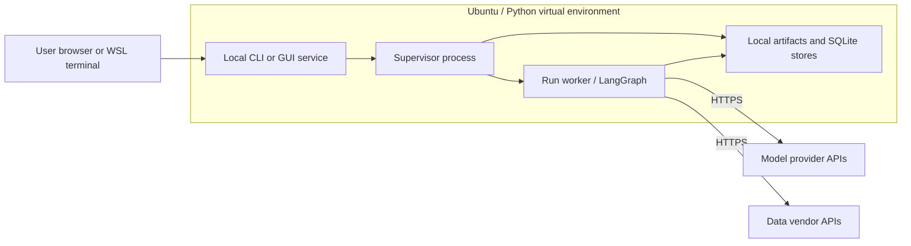

# TradingAgents architecture blueprint

**Status:** Draft for team review; not an approved architecture or implementation record.  
**Accountable owner:** Member B — Architecture.  
**Draft date:** 2026-11-11, Asia/Hong_Kong (UTC+08:00).  
**Target baseline:** TradingAgents v0.7.1.  
**Requirements input:** `requirements-draft(10 11 2026).md`, including Member A's 2026-11-10 21:43 revision.  
**Ownership input:** `Deliverables-and-Ownership.pdf`, especially pages 1–4.

## 1. Purpose and authority

This blueprint describes the proposed components, responsibilities, interfaces, data flow, persistence and deployment for the course extension of TradingAgents v0.7.1. It supports discussion while the requirements are still being confirmed. Requirement IDs below refer to Member A's draft; they do not constitute a second requirements registry.

Member A owns requirement meanings, priorities and acceptance criteria. Member B owns design intent and contracts. Member C owns test procedures and verification conclusions. Member D owns application implementation and baseline experiments. Member E owns governance, CI configuration, the shared traceability matrix and submission assembly. No implementation or verification result is claimed here.

The requirements draft now includes portfolio-dependent validation, whereas the earlier team direction supplied in discussion excluded holdings. This blueprint retains the validation boundary requested by the draft but proposes research-only operation as the initial user-facing mode. Portfolio input, sizing and exposure validation remain conditional on the scope decision in Section 10. No supplied holdings means unknown holdings, never an empty account.

## 2. Design approach and scope

Extend the existing Python/LangGraph application as a modular monolith. Keep the existing analyst, research debate, Trader and risk discussion pipeline. Add shared control and evidence services around that pipeline rather than creating independent services for each agent.

The initial deployment is local WSL/Ubuntu with a CLI and, if FR-002 is retained, a local browser form. Broker integration, order execution and management of a real account are outside this proposed design. A research rating, a Trader proposal and the run's status are separate fields; none initiates an order.

### 2.1 Existing baseline and proposed changes

| Area | v0.7.1 baseline | Proposed extension |
|---|---|---|
| Orchestration | Selected analysts run concurrently; research and risk discussions follow | Shared run context and budget enforcement; deterministic finalization |
| Model calls | Provider clients, retries, structured outputs and per-scope limits | One run-wide dispatch gateway, including retries and memory calls |
| Data access | Method router plus direct vendor access in some agent paths | Route all retrieval through one boundary; normalize evidence and coverage |
| Historical data | Per-channel date guards and memory cutoff | Common admission checks and whole-run prompt provenance |
| Output | Research rating or `REVIEW`; Markdown/HTML reporting | Typed result envelope, deterministic status, citation checks and coverage section |
| Persistence | SQLite checkpoints, memory log and existing result files | Unique run/attempt identity, checkpoint catalogue and immutable final manifest |
| Input | CLI | Shared application service, also usable by a thin GUI |

Baseline anchors: `tradingagents/graph/{trading_graph,setup,checkpointer,conditional_logic}.py`, `tradingagents/dataflows/{router,date_window}.py`, `tradingagents/agents/{tools,context,rating}.py`, `tradingagents/agents/analysts/sentiment_analyst.py`, `cli/{main,run}.py`. Paths are relative to the v0.7.1 source root. New modules named below are proposals, not existing files.

## 3. Component and dependency view



The supervisor supplies operational termination facts to the finalizer. The gate alone produces the three validation statuses. The finalizer persists and exposes the decision without reinterpreting it. Model text and retrieved content cannot write policy, counters or result status.

| Component / proposed location | Responsibility and interface boundary | Main requirement links |
|---|---|---|
| Run service — `tradingagents/runtime/service.py` | Validate ticker/date, start, inspect, resume or rerun; one entry point for CLI and GUI | FR-002, FR-003, RUN-001 |
| Supervisor — `runtime/supervisor.py` | Own run lifecycle, deadline, cancellation and exception mapping; prevent late results from changing a terminal outcome | RUN-001, NFR-001, PERF-002 |
| Contracts — `runtime/contracts.py` | Versioned request/result types and enums; no vendor or provider imports | RUN-001, ARCH-002 |
| Model gateway — `runtime/model_gateway.py` | Reserve calls atomically, bound retries, account for tokens, enforce cancellation across all branches | COST-001/002, PERF-002 |
| Evidence gateway — `dataflows/evidence_gateway.py` | Call router, normalize responses, enforce historical admission and register evidence | FR-001, FR-004, ARCH-001 |
| Coverage ledger — `dataflows/coverage.py` | Collect typed availability outcomes independent of model prose | FR-005, NFR-001 |
| Existing graph and agent modules | Produce analyses and proposals using approved data/model interfaces | NFR-002, COST-003 |
| Validation gate — `validation/gate.py` | Check citation resolution, proposal readability and, conditionally, exposure; derive validation status from trusted inputs | ARCH-002, SEC-001, SAFETY-001, SAFETY-002 |
| Artifact store — `runtime/artifacts.py` | Unique output directories, immutable final record, structured events and redaction | OBS-001, REPRO-001, SEC-002 |
| Reporting integration — existing `reporting.py`, `report_html.py`, CLI reporting | Display rating/action/status separately; render coverage and limitations from typed records | FR-001/005, RUN-001, SEC-003 |
| Checkpoint adapter — existing checkpointer plus catalogue | Expose persisted tasks, compatibility signature, resume and explicit rerun | FR-003 |

Requirement prefixes in tables are abbreviated: for example, FR-001 means REQ-TA-FR-001 and COST-002 means REQ-TA-NFR-COST-002.

### 3.1 Enforced dependency direction

- CLI/GUI depend on the run service, not vendor modules or individual graph nodes.
- Agents and graph code use registered tools, the evidence gateway and model gateway. They do not import vendor modules or `yfinance` directly.
- Vendor implementations remain under `dataflows/vendors/`; the router owns vendor selection and fallback. An adapter converts existing text sentinels to typed outcomes at this boundary.
- The gate depends on contracts, the immutable policy and evidence lookups. It has no LLM client and performs no network requests.
- The artifact store and all output sinks use one redaction service. Authentication tokens and secret environment values never enter the serializable run context.

Move the four direct imports identified by ARCH-001 behind router methods: company profile in `agents/context.py`, market snapshot in `agents/tools.py`, and Reddit/StockTwits in the sentiment analyst. Memory lessons also pass admission checks, although memory is a local store rather than a data vendor.

## 4. Input and result contracts

These are interface sketches to be expanded in Member B's `interface-contracts.md`; exact field names remain provisional.

| Contract | Essential fields and rules |
|---|---|
| `RunRequest` | `ticker`, `analysis_date`, selected analysts, configuration reference, mode (`fresh`, `resume`, `rerun`), optional checkpoint reference. Holdings input is conditional on scope approval. |
| `RunContext` | `run_id`, `attempt_id`, start time, trusted `as_of` cutoff, config snapshot, policy snapshot/hash, prompt hash and budget handles. Pass explicitly into concurrent tasks. |
| `EvidenceRecord` | `evidence_id`, canonical ticker, channel, source identifier, source URL if safe, `observed_at` and/or `published_at`, plus `filed_at`/`resolved_at` when applicable, retrieval time, content hash, normalized payload and admission outcome. |
| `ChannelOutcome` | Channel, request/window identity, available item IDs, availability state, one of the four FR-005 gap codes when applicable, and redacted diagnostic details. Partial coverage preserves both available items and gaps. |
| `ResearchProposal` | Five-tier research rating or unreadable marker; separate three-action Trader proposal; rationale, cited IDs and optional structured sizing fields. Any model-supplied status is untrusted and discarded. |
| `RunResult` | Schema version, run/attempt IDs, exactly one terminal status, permitted reason code or null, separate research rating and Trader action, evidence/coverage references and artifact references. Partial narrative is clearly labelled and cannot masquerade as a final call. |
| `CheckpointSummary` | Run/attempt identity, ticker, date, compatibility signature, persisted task IDs/count, pending tasks and resumability state. |

### 4.1 Research meaning

Preserve the five research ratings: Buy, Overweight, Hold, Underweight and Sell. Preserve the Trader's distinct Buy/Hold/Sell proposal. `REVIEW` is an unreadable-rating fallback, not a sixth opinion and not equivalent to Hold.

For research-only operation, propose a deterministic explanation of Hold: “No new directional action is supported by the current evidence.” No report may infer an existing position. This wording comes from the earlier team discussion and needs Member A to incorporate it into the requirements baseline; it is not silently substituted for the current draft.

### 4.2 Status ownership and precedence

Retain the draft's external closed set: `COMPLETE`, `INCOMPLETE`, `RESEARCH_ONLY`, `REVIEW_REQUIRED`, `VALIDATED_RESEARCH`. Keep execution progress (`queued`, `running`, `stopping`) internal and separate from terminal status.

Proposed precedence, subject to the conflicts in Section 10:

1. Operational interruption or required price-data failure: supervisor produces `INCOMPLETE` with the applicable RUN-001 reason. Final rating/action fields are null.
2. Finished pipeline with unreadable final rating or unresolved citations: gate produces `REVIEW_REQUIRED(RATING_UNREADABLE/EVIDENCE_UNRESOLVED)`.
3. Size-dependent proposal with missing holdings or unknown cap: gate produces `RESEARCH_ONLY(NO_HOLDINGS/EXPOSURE_CAP_UNKNOWN)`; missing cash and over-cap treatment follow the agreed NH rules.
4. Complete readable research with no size validation requested: propose `COMPLETE`, matching NH-1's non-size-dependent case.
5. Position validation, if approved in scope, can produce `VALIDATED_RESEARCH` only after deterministic checks on explicitly supplied, sufficient context. Validation never means a guarantee of returns or permission to execute a trade.

The gate returns a typed decision, and a single finalization path exposes it. It does not copy a model-generated enum. Multiple concurrent failures are arbitrated once under a lock; later failures become diagnostic events. Invalid user input is rejected before a run starts, with field-level errors rather than an invented terminal reason.

## 5. Data flow and trust boundaries

### 5.1 Normal run

1. CLI or GUI submits a request to the run service. Validate syntax and resolve the instrument through the shared data boundary; do not treat a vendor outage as proof of an unknown ticker.
2. Create the run identity, immutable config/policy snapshots and initial journal. Select compatible checkpoint state only for an explicit resume.
3. Start the supervised graph. Analysts and existing memory settlement may execute concurrently; all provider dispatches share the same budget.
4. Route evidence requests with the trusted analysis cutoff. Normalize, filter and register admissible items before including them in any prompt. Record every gap independently of narrative text.
5. Run the existing research debate, Trader and risk discussion. Collect a structured final proposal and cited evidence IDs.
6. Run deterministic validation. Finalize exactly once, render coverage/status/evidence sections, and write the final immutable manifest after the artifact set is committed.
7. Return the result to the CLI/GUI. The GUI observes progress through the run service and cannot modify graph state directly.

### 5.2 Evidence and historical integrity

Use a deterministic ID derived from canonical source identity, instrument, relevant knowledge timestamps and normalized content hash. Retrieval time is recorded but excluded from the ID so retrieving identical evidence twice does not create a different identity. Changed content produces a new record. Keep per-run references so cross-run deduplication does not erase provenance.

Observation time alone is insufficient: a statement for an old quarter may have been filed later. Admission must check when information became knowable, including filing, publication, vintage and settlement/resolution times. Retain both economic observation time and knowledge time. Never substitute retrieval time for missing publication time.

Keep the existing twelve-channel guards and add shared admission at the prompt boundary, including market snapshots, social posts, instrument context and memory lessons. On historical runs, exclude undated items and live-only profiles/prediction markets; the labelled current-name exception remains narrow. Define end-of-day timezone handling with Member A before implementing comparisons.

Coverage is generated from typed tool outcomes, not inferred from an empty model report. Preserve `VENDOR_UNAVAILABLE`, `NO_DATA`, `WINDOW_NOT_OBSERVED` and `WITHHELD_HISTORICAL`. A successful fallback is not an all-vendors failure. Proposed core price gaps stop the run; non-core gaps remain visible while processing continues. Staleness thresholds and the exact core boundary require agreement.

### 5.3 Untrusted text and output handling

Retrieved content is evidence, not an instruction source. It cannot update policy, budgets, status or exposure limits. Delimit evidence in prompts and keep IDs in structured context. Resolve citations against the registry, not against text that merely looks like an ID.

Build report status, limitations, coverage and evidence references deterministically. Escape model/vendor content in HTML and avoid executing embedded markup or scripts. A guarantee-phrase check and fixed disclaimer support SEC-003, but a phrase list is not a proof of semantic safety; Member C owns the evaluation cases and results.

## 6. Budgets, failures and cancellation

**Calls:** reserve one call under a run-scoped atomic lock before each physical provider dispatch. Count retries, structured-output re-requests and background memory calls. Disable hidden SDK retries or instrument them at the transport boundary; wrapping only a top-level agent invocation cannot meet COST-002. Persist reservations so resuming does not reset the cap. A crash after reservation may conservatively consume a slot even if transmission is uncertain.

**Tokens:** record input/output usage and whether usage is known. A strict aggregate cap requires reserving a conservative input estimate and bounded output allowance before concurrent dispatches, then reconciling actual usage. If the provider cannot supply reliable bounds or usage, record inconclusive compliance; do not silently count zero. The draft does not yet define the corresponding terminal reason. Full compliance remains conditional on a provider-specific design and Member D's measurements.

**Time:** use a monotonic deadline independent of timestamps in reports. Node-boundary checks alone cannot ensure return within budget plus two seconds when a network call blocks. Propose a supervised worker process for each active run, provider timeouts bounded by remaining time, cooperative cancellation first, and process termination as a fallback. The supervisor owns finalization, so a terminated worker cannot overwrite the terminal result. Remote requests already sent may still incur usage; record unknown usage where necessary.

**Failures:** translate known operational exceptions and core coverage gaps to typed termination facts. Preserve redacted causes separately from reason codes. An uncaught internal failure or storage failure must not be labelled `COMPLETE`; the reason vocabulary for these cases requires agreement. No architecture can guarantee a durable final record during total disk failure or machine power loss. Recovery journals make interruptions discoverable on restart.

Early debate convergence is an optional extension behind an explicit policy setting. Keep the upstream round limit until the convergence signal and quality effect have been agreed and evaluated.

## 7. Persistence, memory and reproducibility

Proposed storage layout:

```text
results/<run_id>/<attempt_id>/
  events.jsonl                 # redacted structured lifecycle events
  evidence.jsonl               # evidence records admitted during the attempt
  coverage.json               # deterministic channel outcomes
  report.md
  report.html                 # if enabled
  manifest.json               # final immutable record; written once
state/
  run-catalogue.sqlite        # run/attempt/checkpoint index and recovery state
  checkpoints/               # existing LangGraph checkpoint storage
  budget-journal.sqlite      # dispatch reservations and reconciled usage
```

Use random unique IDs rather than ticker/date or second-resolution directory names. Write a final manifest through an exclusive, atomic commit; never update a previous attempt's final record. Runtime journals are mutable until terminal finalization and are not presented as immutable final manifests.

A resume keeps the logical `run_id` and cumulative budgets but creates a new `attempt_id` linked to the previous attempt and checkpoint. A rerun creates a new logical run and a new budget, clears only the selected checkpoint/thread, and preserves earlier artifacts. This interpretation of “one record per run” needs Member A's confirmation; an alternative is one final manifest per logical run with separate attempt journals.

Catalogue persisted task identities, not only graph step numbers. Preserve completed parallel branch tasks. Include configuration, graph shape, policy and prompt hashes in compatibility checks; a mismatch starts fresh or requires an explicit rerun. Retain upstream signature safeguards and reject old incompatible checkpoints rather than force-resuming them.

For REPRO-001, record exactly the required `DEFAULT_CONFIG` keys minus the named exclusion list in `config`; represent endpoints only as set/not set. Additional proposed provenance fields belong outside that exact key set. Hash versioned prompt templates deterministically by sorted relative path and file bytes. Inline prompts need an explicit inventory; hashing only a nonexistent prompt directory would miss changes.

Propose separate provenance for the resolved provider/model identifiers, source revision/tree hash, memory snapshot reference and cache policy. These improve comparability but need approval because they exceed the minimum draft fields. A config record alone does not reproduce changing live vendor data or evolving model services.

Memory is a distinct source with temporal admission: a lesson resolved after the analysis date cannot enter the run. Background settlement is subject to the model budget, and lessons consulted by a run should be identifiable in its provenance. Do not place secrets or arbitrary unredacted provider responses in persistent state.

## 8. Deployment view



Development baseline is `/home/brian/projects/TradingAgents-0.7.1` with its own `.venv`. The WSL `ta` function launches this baseline. The project extension should be tracked in the team's agreed repository; this blueprint does not imply that the installed source archive is already that repository.

Propose a GUI bound to loopback only, with server-side input validation, one active run initially, and background execution so the form remains responsive. GUI framework and packaging remain a small ADR decision. External access, multi-user identity and public hosting are not assumed.

Load secrets locally through the existing environment/authentication mechanism. Give the worker only required credentials; persist a secret-free config projection. Keep existing upstream functionality available through a compatibility adapter while the CLI migrates to the new `RunResult` contract. A compatibility path must not bypass the gate or imply completion from the old tuple alone.

## 9. Verification seams and ownership handoffs

This section describes design support for verification, not Member C's test plan or claims of passing tests.

| Design seam | Evidence enabled | Owner handoff |
|---|---|---|
| Injected model gateway and fixture vendor router | Offline dispatch counts, timeouts, malformed responses and no-network runs | B specifies interfaces; C writes tests; D integrates |
| Capturable prompt boundary and evidence registry | Future-marker exclusion, control-item inclusion and citation resolution | B defines provenance; C owns FR-001/004 fixtures |
| Typed coverage ledger and deterministic renderer | Byte-stable coverage section independent of model prose | C verifies FR-005; D implements |
| Immutable policy and gate decision type | Status origin and malicious-content boundary assertions | B specifies rules after A resolves ambiguity; C verifies |
| Budget journal and checkpoint catalogue | Concurrent cap enforcement and zero replay of persisted tasks | C tests interruption/resume; D supplies executable hooks |
| Redacted events and immutable manifests | Structured fields, distinct repeated runs and secret scanning | C verifies; D uses manifests for benchmarks |
| Registration-only analyst definition | New analyst without orchestration changes | Optional NFR-002 implementation by D, verification by C |

Separate product behaviour from process gates. GOV-001 is a Must in the draft; C owns semantic evaluation design and E owns the CI check and merge enforcement. GOV-002 remains “to be confirmed” in the draft; E/A confirm the course requirement and approval-record format, while C owns the plan. The supplied ownership document is not the full course brief, so this blueprint does not assert that a particular course gate has already been approved or satisfied.

B supplies component/contract references to E's single `docs/traceability/trace-matrix.csv`; A supplies requirement IDs, C test references and D source references. The mappings in this blueprint are architecture allocations, not a competing traceability matrix.

## 10. Open decisions and requirement conflicts

These items must be resolved in the authoritative requirements or an approved ADR. Suggested treatments below are proposals, not baseline changes.

| ID | Decision or conflict | Proposed treatment / accountable reviewer |
|---|---|---|
| O-01 | Earlier team direction excludes holdings; draft requires NH-1–NH-5 and exposure validation | A/team confirm scope. Initial interface remains research-only; conditional portfolio contracts can be deferred without deleting their requirement references. |
| O-02 | RUN-001 says every non-COMPLETE status has a reason, but VALIDATED_RESEARCH has none; COMPLETE permits REVIEW while ARCH-002 sends unreadable output to REVIEW_REQUIRED | A resolves the status table. B proposes null reasons for both successful statuses and unreadable final ratings routed to the gate. |
| O-03 | NFR-001 maps malformed model responses to INCOMPLETE; ARCH-002 maps malformed output to REVIEW_REQUIRED | A distinguish provider/protocol failure from a successfully returned but unreadable final proposal; B then fixes the precedence contract. |
| O-04 | RUN-001 broadly rejects COMPLETE on agent exception; FR-005 permits continuing after non-core vendor gaps | A distinguish normalized recoverable tool gaps from terminal agent failures. Preserve diagnostics for successful fallbacks. |
| O-05 | Core/non-core failure boundary explicitly needs team agreement | A/team confirm the category list; B keeps it in immutable policy rather than scattered conditionals. |
| O-06 | No-holdings prose forbids validation for all five NH states, but NH-2/NH-3 can carry usable context; NH-4 uses EXPOSURE_CAP for unknown cash | A reconcile prose, table and fit criterion. B does not infer that unknown cash means over-cap exposure. |
| O-07 | Unknown token usage has no matching reason; internal errors, cancellation and persistence failures also lack terminal reasons | A extend or clarify the closed vocabulary. B does not silently invent externally visible enums. |
| O-08 | Immutable run record versus resume/attempt updates | A/B approve logical-run and attempt semantics before D implements storage. |
| O-09 | End-of-day timezone, stale-data thresholds and “unknown ticker” versus vendor outage are underspecified | A defines semantics by channel/instrument; B exposes those parameters at admission/input boundaries. |
| O-10 | PERF-001 demands COMPLETE for all benchmark runs, but gate may produce other successful research outcomes | A/C confirm benchmark fixtures and whether COMPLETE is the only accepted success status; D measures only after agreement. |
| O-11 | COST-001 and GOV-001 depend on each other, while token budget and quality threshold are unset | A/C/D establish an unconstrained baseline and fixed quality threshold first, then evaluate the candidate budget. |
| O-12 | Exact config key comparison excludes retries, while retries affect calls/tokens; endpoint booleans cannot distinguish deployments | A/B/C agree supplementary provenance without breaking the exact `config` criterion. |
| O-13 | Two-second cancellation allowance and hard token cap may exceed provider capabilities | D assesses supported clients; C validates with controlled providers. B documents isolation/reservation limits before making guarantees. |

## 11. Proposed ADRs and delivery sequence

Create separate ADR files only as decisions are reviewed. Suggested queue:

1. Modular monolith with shared run service and supervised workers.
2. Research-only scope versus optional portfolio validation.
3. Result status ownership, precedence and error taxonomy.
4. Evidence identity, temporal admission and coverage aggregation.
5. Run/attempt identity, checkpoint compatibility and immutable manifests.
6. Physical-dispatch budgets, retry ownership and cancellation.
7. Local GUI technology and deployment, if retained.

Suggested handoff sequence:

1. A resolves scope/status conflicts; B records accepted architecture decisions and contract types.
2. B expands `interface-contracts.md`, `invariants-and-safety-boundaries.md` and `memory-and-state-design.md`; C prepares the corresponding test plan and fixture inventory.
3. D implements the run service, artifact identity and model/data seams first, followed by the gate and deterministic reporting. C verifies each boundary.
4. Add checkpoint catalogue and GUI; add optional registry/convergence work only when retained in scope.
5. D runs the pinned live baseline; C evaluates quality and constraints; E connects required checks and assembles traceability and submission artifacts.

## 12. Source references and change log

- Requirements source: `D:/CityU Things/Msc EEE Year1 sem1/CS5351 Software Engineering/group project/requirements-draft(10 11 2026).md`.
- Ownership source: `D:/CityU Things/Msc EEE Year1 sem1/CS5351 Software Engineering/group project/Deliverables-and-Ownership.pdf`.
- Upstream baseline: [TradingAgents v0.7.1 source](https://github.com/TauricResearch/TradingAgents/tree/v0.7.1). Baseline file anchors follow the source review and the supplied requirements; proposed changes are not represented as upstream features.
- 2026-11-11 00:00 +08:00 — Initial architecture draft prepared for Member B review from the supplied requirements and ownership split. Scope/status conflicts remain explicit; no requirements, implementation or verification artifacts were modified.
