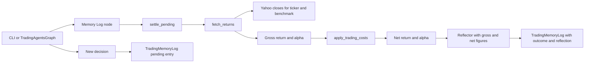

# R4 Architecture Blueprint: Cost-Aware Settlement of Past Decisions

This document covers R4 only. TradingAgents retains its existing analyst, research debate, and trading decision pipeline. The owners of R1, R2, R3, and R5 will document their own changes. See the [R4 requirement](../req/requirements.yaml) and [ADR-0001](adr/0001-r4-cost-policy.md).

## Scope and Boundary

R4 takes a recorded decision, its analysis date and ticker, and settlement settings. Once the holding window is complete, it writes return, benchmark-relative alpha, and a model-generated reflection to the memory log. It has no actual orders, fill prices, quantities, cash ledger, or broker fee statements. Trading costs are an evaluation assumption.

## Module Responsibilities

| Module | R4 responsibility |
| --- | --- |
| `tradingagents/default_config.py` | Defaults and environment overrides for holding period, cost switch, per-side bps, minimum commission, and assumed notional. |
| `tradingagents/memory/settlement.py` | Calculates gross return and benchmark alpha from trading-session prices, applies costs after a complete window, and controls settlement. |
| `tradingagents/memory/reflection.py` | Shows gross and net return and alpha to the LLM when costs are enabled; otherwise keeps the legacy prompt format. |
| `tradingagents/memory/log.py` | Stores pending decisions and atomically records outcomes and reflections. R4 does not change its field format. |
| `tradingagents/graph/trading_graph.py` | Runs the memory step and filters past reflections by resolution date. R4 does not modify this module. |

## Data and Control Flow

1. After an analysis, the final decision is stored as `pending` under `(ticker, trade_date)`. A rerun does not insert a duplicate for the same pair.
2. A later run checks pending decisions. `fetch_returns()` calculates gross return and alpha from ticker and benchmark closes. An incomplete holding window stays pending.
3. With costs enabled, `apply_trading_costs()` deducts the round-trip fee using the effective rate per side. With costs disabled, the gross figures pass through unchanged.
4. The reflection must succeed before the outcome and reflection are written to the existing log. Price, configuration, or model failures leave the entry pending for a later retry.
5. A historical analysis reads only reflections resolved by its analysis date, preventing future outcomes from entering past context.

## External Contract

With costs enabled, the existing `raw` and `alpha` log fields hold net figures. Gross figures enter the reflection prompt but are not stored in new fields. Legacy resolved entries cannot be identified as gross or net from their format alone; comparisons should use a fresh, isolated log. See [Memory and State Design](memory-design.md) and [Invariants](invariants.md).

## Verification, Observability, and Change

Offline tests use fixed prices to check the formula, configuration, log state, and reflection arguments. Separate manual live checks cover the course model, Yahoo historical prices, and the full CLI; one check does not substitute for another. The `settled` and `failed` results and the log's `pending` and `resolved` states show settlement progress. There are no real trade execution metrics.

Adding actual order notional, multicurrency fees, or new log fields requires updating the R4 requirement and [cost policy decision](adr/0001-r4-cost-policy.md), followed by migration and compatibility tests. New defaults must not be applied retroactively to legacy log entries.
